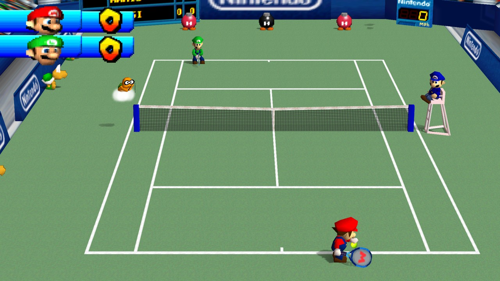
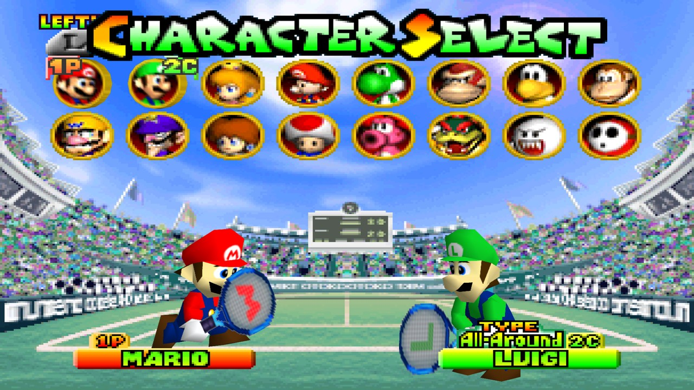

# Mario Tennis: Recompiled

A native PC port of **Mario Tennis (N64, USA)**, made with [N64Recomp](https://github.com/N64Recomp/N64Recomp)
and the [RT64](https://github.com/rt64/rt64) renderer. The original game code is translated into C and
compiled to a Windows program, so it runs natively instead of through an emulator.





> **No game files are included.** This repository holds only the port's own code, tools and artwork.
> You supply the game yourself, and it and everything generated from it stay on your machine.

## Which ROM to use
Use a dump of your own **Mario Tennis** cartridge, **North American (USA) release**. Other regions
(Europe, Japan) won't work.

| | |
|---|---|
| Name | `Mario Tennis (USA).z64` |
| Game code | `NM8E` |
| Format | `.z64` (big-endian). Convert `.n64` or `.v64` files to `.z64` first, e.g. with Tool64 |
| SHA-1 | `999047f07cec931ffbdcc7b33b8502ef602807ee` |

To check your file on Windows, run this in PowerShell and compare the result with the SHA-1 above:

```powershell
Get-FileHash "Mario Tennis (USA).z64" -Algorithm SHA1
```

If it doesn't match, the port won't recognise the file. The usual cause is the wrong region or a modified (hacked or translated) ROM.

## Download
Get `MarioTennisRecompiled-Windows.zip` from the [Releases](https://github.com/Ieatzcrayonz/MarioTennisRecomp/releases) page,
unzip it, run `MarioTennisRecompiled.exe`, pick your ROM and press Start game. The download contains no game
code or data: the game is translated from your own ROM when it starts.

## Features
- Runs at any resolution: 720p, 1080p, 1440p, 4K or matching the window.
- Widescreen: Aspect Ratio **Expand** makes the game draw a wider 3D view matching your window (16:9,
  ultrawide and so on); menus and the score display are stretched to fit. The opening airship flyover stays 4:3.
- Controller support (including DualSense), with rumble and remappable controls.
- Local multiplayer for up to 4 players: each controller is its own player, in the order they were connected.
  "On + Keyboard" also makes the keyboard a player, so one controller and a keyboard can play 2-player
  (Settings → General → Local Multiplayer).
- Saves work as on the cartridge.
- Online play for 2 players (experimental, see [Online play](#online-play-experimental)).
- Bonus characters: Donkey Kong Jr. and Shy Guy are unlocked from the start.
- Transfer Pak characters: Alex, Harry, Nina and Kate from the Game Boy Color version are on Character Select without a Transfer Pak (level 25, starting stats).
- Optional cheats, all off by default (Settings → General): **All Courts**, **Star Characters**,
  **All Tournaments Cleared** and **Infinite Bounces**. The first three are saved with your game
  like normal unlocks, so they stay unlocked after you switch the cheat off.
- A new sunny court launcher screen.
- DirectX 12 or Vulkan (Settings → Graphics → Graphics API).
- Optional CRT shaders from RetroArch (CRT-Royale, CRT-Royale Fast, CRT-Lottes) via librashader
  (Settings → Graphics → Shader).

## Online play (experimental)
Two players can play over the internet or a LAN. Both run the same build of Mario Tennis: Recompiled with the
same ROM; the game runs on both PCs in lockstep and only controller inputs are sent. For now it's set up with
environment variables when starting the game:

- Player 1 (host): `MT_NET_HOST=7777 ./MarioTennisRecompiled`. The host's UDP port (7777 here) must be
  reachable by player 2 (forward it on the router for internet play).
- Player 2: `MT_NET_JOIN=<host address>:7777 ./MarioTennisRecompiled`.
- Optional, host only: `MT_NET_DELAY=<frames>` (default 2). The game runs at 30 frames per second, so 2 frames
  is about 67 ms of input delay; raise it if the game stutters on a slow connection.

Press Start on the launcher on both sides. The host's game waits for player 2 before booting. Each player uses
their own controller (or keyboard) as player 1 would locally; the host is player 1 in the game and the other
player is player 2. Player 2 plays on a copy of the host's save and the host's cheat settings, so both see the
same unlocks; player 2's own save isn't touched. If the two games ever drift apart the log shows
`[net] DESYNC`; please report it with both players' logs.

## Building (Windows)
Requirements: Visual Studio 2022+ Build Tools, LLVM/clang-cl, CMake, Ninja, Python 3 and Git Bash.

1. Clone [Zelda64Recomp](https://github.com/Zelda64Recomp/Zelda64Recomp) with `--recursive` and make a
   `lib` link in this folder pointing at its `lib` folder (it provides RT64, RmlUi, N64ModernRuntime and friends).
2. Apply the patches in `patches/` to `lib/N64ModernRuntime`, `lib/N64ModernRuntime/N64Recomp` and `lib/rt64`.
3. Generate the recompiled code from your ROM: `python tools/gen_symbols.py "<path to Mario Tennis (USA).z64>"`,
   then `sh tools/recompile.sh`.
4. Build: `tools\build_game.bat` (edit the Visual Studio path in it if yours differs). The result is
   `build\MarioTennisRecompiled.exe`. Run it with this folder as the working directory.
5. Release build: `tools\build_live.bat` (output in `build-live\`). It needs no generated code, so step 3 can
   be skipped: the exe translates the game's code, and runs its audio microcode, from the player's ROM at startup.
6. Optional, for the Shader option: build `librashader.dll` from
   [librashader](https://github.com/SnowflakePowered/librashader) (tag `librashader-v0.12.1`) with
   `cargo xtask build --profile release`, and configure with `-DLIBRASHADER_DLL=<path>\librashader.dll` so it is
   copied next to the exe (`tools\build_live.bat` does this for `F:\Recomps\src\librashader`). The shader presets
   in `slang-shaders/` are copied automatically. Without the DLL the game runs normally and the option does nothing.

## Building (Linux, x86_64)
Requirements: clang, CMake, Ninja, Python 3, Git, and the SDL2, GTK 3, Freetype and Vulkan development packages
(Ubuntu/Debian: `libsdl2-dev libgtk-3-dev libfreetype-dev libvulkan-dev`; Arch: `sdl2 gtk3 freetype2 vulkan-headers vulkan-icd-loader`).

1. Clone [Zelda64Recomp](https://github.com/Zelda64Recomp/Zelda64Recomp) with `--recursive` and symlink its `lib`
   folder here: `ln -s <path to Zelda64Recomp>/lib lib`.
2. Apply the patches in `patches/` as on Windows (`git apply` inside each of the three folders). With clang 23 or
   newer, also apply `patches/fmt-clang23.patch` inside `lib/N64ModernRuntime/N64Recomp/lib/fmt`.
3. Build: `sh tools/build_linux.sh`. The result is `build-live/MarioTennisRecompiled`. Run it with this folder as
   the working directory. To make it smaller, `strip` it (it is built with debug info).

Technical notes on how the port works are in [NOTES.md](NOTES.md).

## Credits
- N64Recomp, N64ModernRuntime and the Zelda64Recomp frontend, by Wiseguy and contributors (GPL-3.0).
- RT64 by Darío and contributors.
- [librashader](https://github.com/SnowflakePowered/librashader) by Ronny Chan (MPL-2.0 / GPL-3.0).
- CRT-Royale by TroggleMonkey (GPL-2.0+), CRT-Lottes by Timothy Lottes (public domain), from the libretro
  [slang-shaders](https://github.com/libretro/slang-shaders) collection. See [slang-shaders/README.md](slang-shaders/README.md).
- Barlow and Barlow Condensed fonts by Jeremy Tribby (SIL OFL 1.1, licence in `assets/Barlow-LICENSE.txt`).
- Launcher layout made with [unslop](https://github.com/heydamir/unslop) by Damir Sokolovsky (CC BY 4.0).

Mario Tennis is a trademark of Nintendo. This project is not affiliated with or endorsed by Nintendo.

## License
GPL-3.0, the same as the Zelda64Recomp code it builds on. See [LICENSE](LICENSE).
